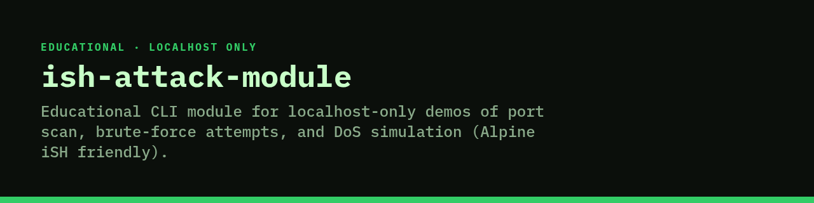

<p align="center">
  
</p>

# ish-attack-module

**Educational CLI module for localhost-only demos of port scan, brute-force attempts, and DoS simulation (Alpine iSH friendly).**

[](#license)


**Educational use only.** Operations are restricted to `127.0.0.1` / `localhost` (and `allowed_targets` in `config/settings.json`). Do not use against systems you do not own or have written permission to test.

## Features

- CLI: `port-scan`, `brute-force`, `ddos` with capped rates/ports/durations
- Interactive menu when run with no args
- pytest suite under `ish-attack-module/tests/`
- Designed to run in Alpine iSH on iOS without pip install

## Tech stack

- Python 3 (stdlib)
- Optional pytest

## How to run

```bash
cd ish-attack-module
python3 main.py --help
python3 main.py port-scan --max-ports 10
python3 main.py brute-force --max-attempts 5
python3 main.py ddos --duration 2 --rps 5
```

## Status

Public. Educational / localhost-only. Not a general attack tool.

## License

All rights reserved. Educational use only.
