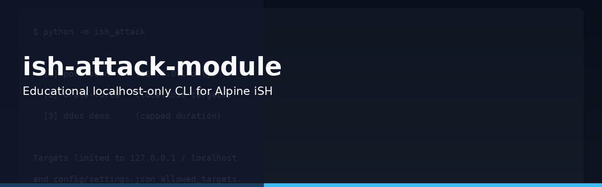
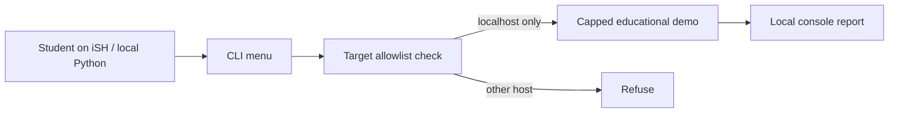

<p align="center">
  
</p>

# ish-attack-module

**Educational CLI module for localhost-only demos of common network concepts (Alpine iSH friendly).**

[](#license)


**Educational use only.** Operations are restricted to `127.0.0.1` / `localhost` (and `allowed_targets` in `config/settings.json`). Do not use against systems you do not own or have written permission to test.

## Features

- Interactive menu and subcommands for localhost-only demos
- Hard target allowlist (`127.0.0.1` / `localhost` + config)
- Caps on rates, ports, and durations
- pytest suite under `ish-attack-module/tests/`
- Designed to run in Alpine iSH on iOS without pip install

## Tech stack

- Python 3 (stdlib)
- Optional pytest

## How it works



Every run checks the target against the allowlist before any demo starts. Non-localhost hosts are refused. Caps keep demos short and local.

## How to run

```bash
cd ish-attack-module
python3 main.py --help
```

See `python3 main.py --help` and `config/settings.json` for available educational demos and allowlisted targets. Use only on localhost.

## Status

Public. Educational / localhost-only. Not a general attack tool.

## License

All rights reserved. Educational use only.
